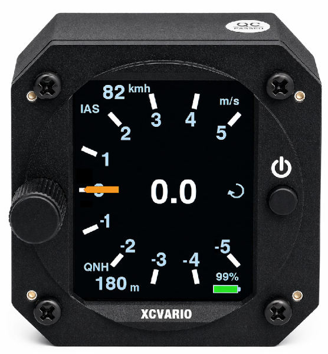

# XCVario Pure

An ESP32-based, lightweight variometer system with an open data interface supporting OpenVario, Cambridge, Borgelt, Naviter, and XCVario protocols, designed for dedicated XCVario hardware.

The project is rooted in the open-source and open-hardware flight computer community and is based on the ESP32 SoC, supporting modern digital sensors such as BMP280, SPL06-007, DS1820B, TE4525, ABPMRR, MP5004DP, AHRS MPU6050, and the QMC5883L magnetometer.

The variometer features a sunlight-readable 2.4-inch IPS LCD display with a brightness of 1000 nits and a low power consumption of less than 1.2 W, corresponding to approximately 100 mA at an operating voltage of 12.5 V. The device measures 64 (H) × 64 (W) × 35 (D) mm, fitting a standard 57 mm (2″) instrument gauge, and weighs approximately 170 grams.

## Vision
The widespread availability of high-fidelity sensors combined with today's highly integrated computing platforms provides an excellent foundation for a project like XCVario Pure. At the same time, it quickly becomes apparent that the overall quality of such a system is determined primarily by its software architecture. Developing a truly high-end variometer therefore requires a significant software investment. Continued improvements in quality, functionality, and usability cannot be achieved with a purely volunteer-driven "pick-it-for-free" approach. Sustained development requires both substantial engineering effort and a sustainable funding model.

The evolution from **XCVario** to **XCVario Pure** therefore comes with the addition of software expertise to the team. The open-source repository will retain all basic features, as it did initially. 
In addition, many features intended to create commercial value will remain closed-source and are therefore not part of this repository. The goal of evolving the variometer into a best-in-class product remains unchanged.

The original ambition of providing a high-quality variometer sensor that turns any club glider with an outdated variometer into a fun-to-fly glider remains unchanged. In addition, new capabilities are being introduced to address several long-standing limitations of conventional variometer designs. The objective is to reduce the pilot's cognitive workload by automating routine tasks, allowing more attention to be focused on safe and efficient cross-country flying.
New features are/will be:

* Auto calibration for TEK and sensor synchronisation/fusion.
  - resulting in uncompromising TE variometer accuracy with a single indicator
  - no requirement for a TE probe any more
  - overcoming the tube latency introduced hurdles from attached probes
* Extended acoustics 
  - morphing a traditional electronic variometer tone to a fully sonified variometer display.
  - assisting flap setting through sounds
  - reintroduces Peter Zander's thermal-assistance audio cues
  - add gust audio overlays to improve interpretation of variometer indications during high-speed cruise
  - route numerous warnings through the acoustic channel
* User interaction
  - refined for intuitive fingertip operation
  - convert numerical values into intuitive pilot guidance (for example, McCready: Slow / Medium / Best Glide)
* Instant wind
  - help the pilot remain aligned with thermal streets and cloud streets

## Downloads, images and video material

[Release builds](https://github.com/hjr/XCVarioPure/releases/)

[More recent materials on the XCVario face-book page](https://www.facebook.com/p/XCvario-100090831756791/)

[A lot of history to the project on YouTube](https://www.youtube.com/results?search_query=xcvario)

## Supported sensors
* TE variometer (TE)
* Airspeed (PI)
* Barometric altitude (BA)
* Outside air temperature
* Battery voltage
* Acceleration and rotation IMU
* Optional earth magnetic field sensor
* Optional flap sensor
* Optional landing gear warning sensor
* Optional GPS NMEA data stream
* Optional FLARM traffic NMEA data stream
* Optional external instant wind sensors (Anemoi)

The ESP32 integrates Bluetooth, Wi-Fi, and multiple serial interfaces, allowing the XCVario Pure to communicate with virtually any modern glide computer. Supported protocols include XCVario, OpenVario, Cambridge, Borgelt, and Naviter, enabling connected devices such as XCSoar, LK8000 and SeeYou to receive TE variometer data, barometric altitude, airspeed, and additional flight information.

## The manual

[Online Handbook in various languages](https://xcvario.com/docs-category/vario)

## Feature list
* Variometer display with adjustable range (1 m/s – 30 m/s) and damping (1 s – 10 s)
* QNH, ballast, bugs, and McCready adjustment, plus many other configurable options
* Vario sound generator with adjustable volume and deadband, plus setup options for tone style profiles
* Sound sequencer with a variety of sound bites for sonification of most visual variometer information
* Integrated loudspeaker with 2-watt audio power
* S2F (Speed-to-Fly) indicator with configurable MC, ballast, and bugs based on glider polars
* Includes aproximately 150 predefined glider polars (list: https://github.com/hjr/XCVarioPure/blob/master/components/glider/PolarTable.txt)
* IAS or TAS airspeed indication
* OAT (Outside Air Temperature) sensor
* Flap assistant with or without flap position sensor
* Battery voltage and status indicator
* Thermal assistant indicator for efficient thermal centering
* Wind rose indicator with optional second, instant wind pointer
* Air mass estimator: EKF fusion of IMU, AHRS, airspeed, baro altitude and GNSS velocity
  - instant 3D wind; the horizontal part drives the instant wind pointer (wind source "XCVario+Instant"); in long straight glides, where the heading is not checked against the GNSS track, the wind turns invalid: the pointer then turns grey and keeps showing the estimate for up to 20 minutes (about 40 km of glide) while its uncertainty stays within twice the validity limits (in the simulation more accurate than holding the last valid wind)
  - vertical air mass movement on the vario with the TE Compensation method "Air Mass", netto or gross as the vario Mode says (netto: the air mass movement, gross: plus the polar sink, the climb of the glider with the air mass filter), insensitive to horizontal gusts and independent of a TE probe; falls back to eComp of the same mode while not available (the first 30 seconds after a start in flight, 5 seconds after an interruption)
  - uses the static port directly, whatever the altimeter source setting, and the gyro without the "Gyro Gating" dead zone; compensates the IMU lever arm and accounts for sideslip from the lateral acceleration
  - runs its own gyro propagated attitude, aided by air data instead of a plain accelerometer gravity reference: pull-ups and zooms do not tilt it, so a stick thermal shows less false climb than TE netto
  - damped with a low pass of a fifth of the Vario Damping setting: it does not take gusts for lift, so it can show a thermal entry about a second earlier than TE netto
  - with Netto Mode "Super-Netto" the circling sink is added (needle, average and audio), showing the climb as if circling there
  - with the Air Mass vario the speed to fly command uses the air mass movement as well, steadier in gusts and pull-ups than TE netto
  - works with the 1 Hz GNSS of the Flarm
  - learns airspeed scale, pitch/AoA offset and the GNSS latency in flight, saved every 5 minutes and after landing; learned values are discarded when the IMU calibration, airspeed calibration, glider or GNSS source changes. The angle of attack scale (the wing's lift slope) is not learned any more: with the offset learned per flap position it is not observable, and on 25 real flights it had run to its limit without changing the vario
  - flapped gliders: the pitch/AoA offset is learned per flap position (flaps shift the fuselage angle of attack by degrees); with a flap sensor it follows the lever, without one the flap recommendation (the glider's flap speeds; the Flap-Assist display need not be enabled), which works as long as the flaps are set roughly as recommended
  - a calibrated compass aligns the heading before the first turn
  - in gusts the energy balance takes the inertial acceleration instead of the airspeed change, so a horizontal gust neither shows as lift nor gets the energy balance distrusted (fully in straight flight, fading out to none at 50° bank: while circling the inertial acceleration was not accurate enough on real flights, the airspeed change takes over there for everything slower than half a second, the inertial acceleration only for the faster part, which keeps the pitot noise off the needle without delaying it)
  - the energy balance always gets the same weight: trusting it less in gusts or pull-ups, which come with the lift in thermals, read climbs about 0.17 m/s low on real flights; its gust corrections (the inertial acceleration, the work of the wind change) count only for seconds, over minutes they were attitude errors and the wobble of the estimated wind, and the vario drifted twice as much as TE netto
  - models the pneumatic lag of the static and pitot lines (0.2 s each, not measured yet), so pull-ups and thermal entries do not show the lag mismatch of the two pressures
  - implausible readings (a sensor glitch, a garbled log line: an airspeed, altitude, acceleration or rotation rate out of range or stepping impossibly far in one sample) are held out like a missing sample, a step that stays is taken over after three samples; the vertical constraints reject innovations beyond 20 m/s, so one corrupt sample cannot drive the vario to hundreds of m/s as it did in a garbled log
  - the pitch path is weighted for the real attitude error (0.03 rad) rather than the simulator's, and the attitude error of the energy balance is tracked over 5 s: on 22 real flights this took the vario's own error over 30 s from 0.19 to 0.12 m/s straight and from 0.13 to 0.11 m/s circling (TE netto 0.16 / 0.10), at the price of a less steady needle in gusts (simulator gust spike 1.5 → 2.1 m/s, TE netto 4.0)
  - while rolling the pitch based estimate is trusted less: adverse yaw sideslips the glider more than the side force shows
  - averaged wind: a 30 s low pass in straight flight, while circling an average over heading sectors, so every heading counts the same also in an unevenly flown circle
  - "Wind to Navi" sends the averaged wind to the navigation computer (`$WIMWV`, Cambridge `!w`)
  - in development builds the "Air Mass Status" page of the vario menu shows the estimator's state, vario, wind, the learned values with their uncertainty, the GNSS age and the sensor biases, live in flight
  - the expert option System > Logging "All Sensor Data" adds the estimator output `$PXCVA`, its start and its setup to the `$SENS` sensor data (about 0.3 kB/s on top of the 1.1 kB/s of `$SENS`, use Wi-Fi or Bluetooth): a flight in the navigation computer's NMEA log can be replayed in the browser replay or on a PC with `tools/airmass_sim` (`sens2rec.py <log> rec.nmea`, then `airmass_replay rec.nmea --csv out.csv`), through the same code the device runs and from the attitude and calibration the device started with; `airmass_replay` compares itself with the recorded `$PXCVA` output
  - the TE "eAdjustment", the only tuning setting, compensates the static port error for Air Mass as for eComp: tune it in calm air until pull-ups show neither false climb nor sink
* Bluetooth, Wi-Fi, and two serial interfaces for external devices (XCSoar, LK8000, FLARM, Anemoi, other sensors …)
* Complete support for a secondary variometer (two-seater) with automatic routing to all connected devices
* High-precision barometric altimeter with 1 hPa (≈ 8 m) absolute accuracy and 0.1 m resolution
* Sunlight-readable, high-contrast 2.4-inch IPS display with 1000 nits brightness
* External switch for S2F / Vario mode
* Setup menu for customization of variometer features
* Support for the FLARM View display
* Output of NMEA data in OpenVario, Borgelt, Cambridge, Naviter, or XCVario format
* OTA (Over-the-Air) software updates via Wi-Fi and web browser
* Attitude and Heading Reference System (AHRS) available since the 2021 hardware revision
* Wind calculation in circling and straight flight (requires a connected GPS source)
* Electronic TE compensation, eliminating long TE tubing and TE probe limitations